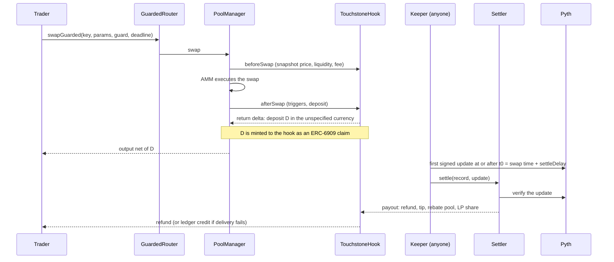

# Touchstone

Touchstone is a Uniswap v4 hook and settlement system. When a swap looks informed, the hook holds a small refundable deposit out of the swap's own output, inside the same transaction. A few seconds later anyone can settle that deposit against a signed Pyth price. If the trade beat the outside price by more than a margin, part of the excess goes to the liquidity providers; everything else returns to the trader. Benign flow is refunded in full and can earn a rebate.

The idea in one line: the pool charges arbitrage what it actually took, proven afterwards with a canonical outside price, and refunds everyone else.

Status: deployed and verified on Arbitrum Sepolia. Testnet only. Not externally audited. See [Scope and limits](#scope-and-limits).

## Contents

1. [The problem](#the-problem)
2. [How it works](#how-it-works)
3. [Architecture](#architecture)
4. [Deployed instance](#deployed-instance)
5. [Repository layout](#repository-layout)
6. [Getting started](#getting-started)
7. [Smart contracts](#smart-contracts)
8. [Off-chain services](#off-chain-services)
9. [Dashboard](#dashboard)
10. [Research and evidence](#research-and-evidence)
11. [Testing and CI](#testing-and-ci)
12. [Gas](#gas)
13. [Security model](#security-model)
14. [Configuration reference](#configuration-reference)
15. [Scope and limits](#scope-and-limits)
16. [Development standards](#development-standards)
17. [AI assistance](#ai-assistance)
18. [Documentation map](#documentation-map)
19. [License and references](#license-and-references)

## The problem

An automated market maker learns the price only from the trades it receives. After the market moves, the pool keeps quoting the old price until someone trades against it. The first trader to do so keeps the difference, and the liquidity providers (LPs) absorb it. The literature measures this as loss-versus-rebalancing (LVR) at the pool level and as markout at the level of a single trade.

Markout compares the price a trader paid with the fair price a short time later. A positive markout means the trader gained and the LPs lost exactly that amount. A study by Uniswap Labs and Columbia, "Not All LPs Are Equal" (arXiv 2609.37963), reports pool-level fee-inclusive markout of about -$5.39 million on Ethereum's USDC-WETH 0.05% v3 pool between February and November 2025, at a 15-second horizon (Table 3). That figure is the pool total, not passive-LP losses.

Most fee hooks try to predict, before the swap, who is informed. Toxicity is hard to predict before a trade and exact a few seconds after it. Touchstone does not predict. It takes a refundable deposit on a broad trigger and judges the trade afterwards.

## How it works

### Life of a flagged swap



1. **Swap.** A trader or router swaps through the PoolManager. `beforeSwap` snapshots the pre-swap price, liquidity and executed fee.
2. **Flag.** `afterSwap` derives the notional from the actual currency deltas and evaluates the triggers below. If one fires, the hook returns a delta in the unspecified currency (the output for exact input, the input for exact output) and mints the deposit to itself as an ERC-6909 claim. The trader signs once, and receives the output already net of the deposit.
3. **Wait.** The record becomes settleable at `t0 = swap time + settleDelay` (3 seconds by default).
4. **Settle.** Anyone fetches the first signed Pyth update at or after `t0` and calls `Settler.settle`. The contract, not the caller, enforces that it is the first such update.
5. **Allocate.** The Settler computes the markout, applies the retention rule, and the hook pays the refund, a settlement tip, a rebate pool contribution and the LP share. If nobody settles within the window, anyone can expire the record for a full refund.

### Triggers

A swap opens a record when any trigger fires. Swaps below `N0` can still flag through the flow trigger.

| Trigger | Fires when |
| --- | --- |
| First touch | The first large swap (notional at least `N0`) in a block. On Arbitrum the block number comes from `ArbSys` |
| Flow | A per-direction leaky bucket, filled by every swap's notional and drained at `N_min` per horizon `h`, reaches `N_min`. Several small trades add up |
| Drift | The swap trades toward a Chainlink reference that is at least `tau` away from the pool price |
| Closed market | The reference market is closed (tokenised-stock pools), by calendar |

### Deposit

```
g      = s * (P_ref - p_pre) / P_ref                    signed gap toward the reference, in bps
rate   = min(delta_max, max(delta, beta * max(g, 0)))   continuous pools
D      = N * rate / 10,000                              closure records use delta_c instead
```

`N` is the swap's quote notional. `D` is taken in the unspecified currency at the swap's own execution price, so no oracle is read to size it.

### Settlement

```
m = x_r * P* + x_q                                       trader markout at the signed price P*
R = min(D, alpha * max(0, m+ - (eps + c*) * N+))         retained amount
refund = D - R
```

`x_r` and `x_q` are the trader's signed risky and quote receipts from the AMM delta. `m+` and `N+` count only the in-the-money leg, so padding a trade past the reference cannot dilute its markout. `c*` is the Pyth confidence, in bps. `alpha` is the retention share and `eps` the margin.

The retained amount splits into a settlement tip, a share that funds rebates, an optional protocol share and the LP share, which vests over time through a donation to in-range liquidity. The hook checks that refund, tip, protocol share, rebate and LP share add up to the deposit exactly before it pays anything.

Guards that refund the whole deposit: Pyth confidence above `maxConfBps`; a closure record whose price jump exceeds `jumpRefundBps`; no usable update inside the window.

A benign record (`R = 0` and `m <= 0`) is refunded in full and can earn a rebate of `min(pool balance, N * fee * kappa)`, funded from earlier retained value.

[Formulas and research basis](docs/formulas.md) lists every variable with its source. [Formula definitions and implementation](docs/formulas-research-and-current-code.md) maps each line to code.

### Four markets

| Market | What it does |
| --- | --- |
| Clawback | Keeps part of a positive markout from the deposit, never more than the deposit |
| Arbitrage licence | A leased right for one holder to trade inside a band around the reference without retention, paying rent to LPs. Adapted from am-AMM (arXiv 2403.03367) |
| Benign-flow rebates | Flow that settles benign is refunded in full and can earn a rebate |
| Quote integrity | `previewDeposit`, a URC-4 indicative quote and a guarded router make the deposit visible before signing and enforce limits inside the transaction |

Closed markets use their own parameters: a flat closure deposit, settlement at the reopen, `alpha_c` 50% and `eps_c` 50 bps, because over a weekend an uninformed trader's markout is mostly noise.

## Architecture

| Component | Responsibility |
| --- | --- |
| `TouchstoneHook` | The v4 hook (flags `0x20C4`: beforeInitialize, beforeSwap, afterSwap, afterSwapReturnDelta). Flags swaps, takes deposits, finalises payouts, drips vested LP income |
| `Settler` | Verifies one signed Pyth update, computes markout and the payout split. Holds no funds |
| `TouchstoneFactory` | Registers pools and fixes each pool's configuration at creation |
| `RebateLedger` | Holds rebates and any refund or tip that could not be delivered, claimable by its owner |
| `GuardedRouter` | The contract a trader calls. Enforces `minNetOut`, `maxDeposit`, `maxNetIn` and a deadline in the same transaction |
| `TouchstoneLens` | Quote logic served through the hook's fallback: `previewDeposit`, URC-4 `getIndicativeQuote`, `swapToPrice`, `maxGas`. Keeps the hook under the contract size limit |
| `LicenceAuction` | The arbitrage licence: bids, notice period, rent and lapse |
| `NyseCalendar` | Market calendar for closed-market mode on tokenised-stock pools |

Off chain: a keeper that settles and expires records, an indexer with a read-only history API, an alert monitor, demonstration bots, and a dashboard that previews, signs and follows a swap through settlement. The research code and a Rust bytecode-replay engine sit beside them.

## Deployed instance

Arbitrum Sepolia (chain id 421614), deployed 7 November 2026. All seven contracts are verified on Arbiscan. The full manifest, with block numbers and transaction hashes, is in [DEPLOYMENTS.md](DEPLOYMENTS.md).

| Contract | Address | Deployment block (L2) |
| --- | --- | ---: |
| TouchstoneHook | [`0xeD486b0a1d875bBac3DE259AFc583984389420c4`](https://sepolia.arbiscan.io/address/0xeD486b0a1d875bBac3DE259AFc583984389420c4#code) | 326729262 |
| TouchstoneLens | [`0x4085E5BD0D5a60128487705D017F2B312AFAefd2`](https://sepolia.arbiscan.io/address/0x4085E5BD0D5a60128487705D017F2B312AFAefd2#code) | 326729255 |
| Settler | [`0xBC3ff14B7e4cC5549f52436a45F74EF5d4caf287`](https://sepolia.arbiscan.io/address/0xBC3ff14B7e4cC5549f52436a45F74EF5d4caf287#code) | 326729239 |
| RebateLedger | [`0x693a7eF9cF0eA06b634f3673C2805627Eb7e78f8`](https://sepolia.arbiscan.io/address/0x693a7eF9cF0eA06b634f3673C2805627Eb7e78f8#code) | 326729230 |
| TouchstoneFactory | [`0xfbbBC7b89682BeCC22ddFCe4B8941cd2867466Fb`](https://sepolia.arbiscan.io/address/0xfbbBC7b89682BeCC22ddFCe4B8941cd2867466Fb#code) | 326729235 |
| GuardedRouter | [`0xdb8C7995200759C6FD5c5f5c803d94184A577Ddb`](https://sepolia.arbiscan.io/address/0xdb8C7995200759C6FD5c5f5c803d94184A577Ddb#code) | 326729245 |
| LicenceAuction | [`0xA050C01CeeCA0F8c5158223C5C2bDF8B69Ac0b89`](https://sepolia.arbiscan.io/address/0xA050C01CeeCA0F8c5158223C5C2bDF8B69Ac0b89#code) | 326729250 |

Demo pool: native ETH / Circle USDC, 0.05% fee, tick spacing 60, pool id `0x09741a6de859ce342be323e80855894ab0a44691d286784447041d056b448051`. It is seeded with a 15 USDC full-range backstop and a 60 USDC band within about 3% of the Chainlink price ([decision 0067](docs/decisions/0067-demo-pool-band-liquidity.md)).

External dependencies: Uniswap v4 PoolManager `0xFB3e0C6F74eB1a21CC1Da29aeC80D2Dfe6C9a317`, Pyth `0x4374e5a8b9C22271E9EB878A2AA31DE97DF15DAF`, Chainlink ETH/USD `0xd30e2101a97dcbAeBCBC04F14C3f624E67A35165`, Circle USDC `0x75faf114eafb1BDbe2F0316DF893fd58CE46AA4d`.

The dollar thresholds on this pool are scaled down 1,000 times from the specification (`N0` 5 USDC instead of $5,000, `N_min` 100 USDC instead of $100,000) because the pool holds about 75 USDC. All ratios (`tau`, `delta`, `beta`, `alpha`, `eps`, `h`) are at their specification values.

## Repository layout

```
contracts/            Foundry project (Solidity 0.8.26, Cancun EVM)
  src/                Hook, Settler, Factory, Ledger, Licence, periphery, libraries, types
  test/               unit, adversarial, differential, fork, gas, integration, invariant, mocks
  script/             DeployCore, CreatePool, and per-chain configuration in script/config/
  deployments/        Deployment records written by the scripts
  lib/                Vendored dependencies at the commits in lib/PINS.md
backend/              pnpm workspace, Node 24 with native TypeScript
  keeper/             Settles, expires, drips, accrues; Hermes client; state and metrics
  indexer/            SQLite event store, read-only history API, alert monitor
  bots/               Testnet demonstration traders
  cloudflare-keeper/  Alternate keeper runtime on Cloudflare Workers
  shared/             ABIs, record type, environment validation, logging
frontend/             Vite and React dashboard with the documentation reader
research/             Pre-registered experiments (Python), results, reference vectors
sim/                  Rust bytecode-replay engine
docs/                 Formulas, runbook, threat model, gas, lessons, decisions, audit records
scripts/              Deployment, rehearsal, service launcher and release-gate checks
.github/workflows/    Continuous integration
```

## Getting started

Requirements: Node.js 24 and pnpm 10.14.0; Foundry 1.5.1 with Solidity 0.8.26 and the Cancun target; Python 3.13 with uv (research); Rust and Cargo (replay engine). Dependencies are vendored or locked.

```sh
git clone https://github.com/PrazwalR/Touchstone.git
cd Touchstone
cp .env.example .env        # fill in what you need; never commit it
```

Contracts:

```sh
cd contracts
forge fmt --check && forge build --sizes
forge test
forge test --match-path "test/invariant/**"
```

Dashboard:

```sh
pnpm -C frontend install --frozen-lockfile
pnpm -C frontend dev        # http://localhost:5173
pnpm -C frontend build
```

Backend and services:

```sh
pnpm -C backend install --frozen-lockfile
pnpm -C backend abi         # regenerate ABIs after a contract build
pnpm -C backend typecheck && pnpm -C backend test
pnpm -C backend preflight   # validates configuration, keystore permissions and deployment wiring
scripts/run-services.sh     # indexer, read-only API, keeper and alert monitor
```

Deploying to a testnet (Arbitrum Sepolia or Base Sepolia). The script rehearses on a fork, checks funds, deploys with explorer verification, syncs the dashboard and prints the environment lines the services need. `cast` asks for the keystore password; the script never sees it.

```sh
cast wallet import touchstone-deployer --interactive
set -a; . ./.env; set +a
scripts/rehearse-deploy.sh arbitrum-sepolia     # fork rehearsal, touches nothing live
scripts/deploy-testnet.sh arbitrum-sepolia
```

The [runbook](docs/runbook.md) covers keeper keys, funding, alerts and incident response.

## Smart contracts

**Hook.** Permissions are `beforeInitialize`, `beforeSwap`, `afterSwap` and `afterSwapReturnDelta`; the address is mined with CREATE2 so its low bits carry them. The deployed runtime is 23,993 bytes against the 24,576-byte limit, which is why quote interfaces are served through a fallback to the lens. Transient storage carries first-touch state through a transaction. There is no owner, upgrade proxy, `delegatecall` or `selfdestruct`.

**Pool configuration.** Fixed at registration by the factory in a packed `PoolConfig`: triggers, deposit schedule, settlement window and lag, retention and margin, rebate and vesting parameters, oracle feeds and price ids, licence terms. Nothing is hardcoded in logic; contract-wide values are constructor immutables.

**Libraries.**

| Library | Job |
| --- | --- |
| `TriggerLib`, `FlowBucketLib`, `BlockLib` | Trigger bitmask, leaky buckets, chain block source |
| `DepositLib`, `PriceLib`, `ReferenceLib` | Deposit rate and conversion, price scaling, Chainlink reads and staleness checks |
| `SettlementMath`, `ItmLib` | Markout, clawback, payout split and conservation, in-the-money leg |
| `VestingLib`, `RecordLib`, `TransientLib` | LP vesting, record hashing, transient-storage helpers |
| `StaticQuoteLib`, `CalendarMath` | Tick-walking quote, market calendar arithmetic |

**Interfaces.** Records are committed by hash and emitted in full in `DepositTaken`, so a keeper settles without storage reads. The hook implements URC-2 style `HookSwap` events and URC-4 `getIndicativeQuote`, `isLive`, `maxGas` and `swapToPrice`.

**Router guard.** `GuardedRouter.swapGuarded` takes `maxDeposit`, `minNetOut`, `minGrossOut`, `maxNetIn` and a deadline. If the deposit or the amounts break the limits, the transaction reverts.

**Invariants tested.** Payout conservation; retained amount never above the deposit; deposits outstanding within the configured budget; split trades fill a flow bucket like the whole trade; settlement closes a record exactly once.

## Off-chain services

| Service | What it does |
| --- | --- |
| Keeper (`backend/keeper`) | Ingests `DepositTaken`, reads the schedule from `Settler.settleTime`, fetches the first Hermes update at or after `t0`, simulates, then settles or expires. Also drips vested LP income, pushes ledger balances and accrues licence rent. It settles when the result retains something, when the record is benign with no rebate, or when the tip covers gas; other records are left to expire and re-checked on a configurable interval |
| Indexer (`backend/indexer`) | Every Touchstone event plus the pool's Swap, ModifyLiquidity and Donate events in SQLite (`node:sqlite`), idempotent, with reorg detection and per-pool derived tables |
| History API | Read-only HTTP view over the indexer database, with an origin allowlist and rate limits |
| Monitor | Discord alerts: settlement lag above the delay plus slack, records that expired, Hermes error rate, stale keeper metrics, low keeper balance |
| Bots (`backend/bots`) | Seeded, bounded testnet traders (retail, outsider, licence holder, bidder), all logged as testnet demonstration |
| Cloudflare keeper | The settlement loop on Cloudflare Workers with a Durable Object journal |

All configuration is read from the environment and validated once at startup with `zod`; a missing or malformed value fails the process. Secrets stay out of the repository and out of browser bundles.

## Dashboard

Vite, React 19, TypeScript, viem and Tailwind CSS, with a WebGL illustration. Four views:

- **Overview:** the mechanism as a scroll-driven illustration, a settlement laboratory, the four markets and the verified status.
- **Swap:** a quote and guarded swap through the router.
- **Simulation:** reads the pool and Chainlink, prepares a trade, previews the deposit with `previewDeposit`, signs once, and follows the record through the Pyth price, markout and payout. Trades that would cost more than 5% of price are refused unless they move an out-of-range pool back toward the reference.
- **Docs:** the formulas, research results, lessons, decisions, runbook, gas and threat model.

The dashboard is read-only apart from the user's own wallet transaction, and has no API keys in its bundle. Configuration (`VITE_CHAIN`, `VITE_RPC_URL`, `VITE_HISTORY_URL`, `VITE_POLL_SECONDS`) is described in [frontend/README.md](frontend/README.md).

## Research and evidence

Experiments are pre-registered and hashed before they run, and results record the registration hash, the analysis-code hash and the SHA-256 of every input dataset. Thresholds are never changed after a run.

| Experiment | What it tests | Result |
| --- | --- | --- |
| E1 | Markout census and trigger calibration, 209,406 swaps (30 Aug to 27 Sep 2026) | Descriptive. Swaps of $25,000 or more carry 97% of toxic markout; the 72% of swaps under $5,000 carry 0.3% |
| E2 | Trigger recall on a held-out window, 184,145 swaps (27 Sep to 25 Oct 2026) | Pass. Recall 98.9% (95% interval 98.6% to 99.2%), 23.4% of swaps and 89.6% of volume flagged |
| E3, E4 | Settlement replay and Pyth versus reference basis | Registered and frozen; no verdict recorded |
| E5 | Evasion by splitting and delay | Simulation. No formal kill, because the break-even recall is negative on this window; recall falls to 9.7 to 11.1% for pieces under a tenth of `N_min` |
| E6 | Pool freshness against a static-fee pool | Simulation. All 21 registered cases failed the threshold; held-out price error was 39.2% to 73.3% higher |
| E7, E10, E11 | Margins, licence economics, further sensitivities | Drafts |
| E9 | Skipped by decision | Not run |

Every number carries one label: measured, historical backtest, simulation, testnet demonstration, or target. Historical backtests, simulations, software tests and testnet transactions answer different questions, and testnet flow says nothing about LP returns. The full write-up, caveats and reproduction commands are in [research/results/README.md](research/results/README.md) and [research/README.md](research/README.md).

## Testing and CI

| Layer | Coverage |
| --- | --- |
| Contracts | 254 forge tests across 37 suites (unit, adversarial, differential, integration, gas) plus 3 fork tests, 11 invariant tests, line and branch coverage above 99% on `src/` |
| Backend | Keeper, indexer, bots and Cloudflare keeper unit tests, plus Anvil end-to-end suites |
| Frontend | Unit tests for swap, quote, settlement and docs logic; production build; `pnpm audit` |
| Research | `ruff`, `mypy` and `pytest`; a script that reproduces every number the specification quotes |
| Rust | `fmt`, `clippy -D warnings`, tests, and a bytecode replay against Anvil |

Continuous integration (`.github/workflows/ci.yml`) runs formatting, build and size checks, tests, the invariant suites, a gas regression gate (5% tolerance), a coverage gate, Slither with a triage fingerprint file, dependency audits (`pnpm audit`, `pip-audit`) and secret scanning configuration (`.gitleaks.toml`).

Local validation:

| Component | Commands |
| --- | --- |
| Contracts | `cd contracts && forge fmt --check && forge build --sizes && forge test` |
| Backend | `pnpm -C backend typecheck && pnpm -C backend test` |
| Frontend | `pnpm -C frontend typecheck && pnpm -C frontend test && pnpm -C frontend build` |
| Research | `cd research && uv sync --locked && uv run ruff check . && uv run mypy && uv run pytest` |
| Rust | `cd sim && cargo fmt --check && cargo clippy --locked --all-targets -- -D warnings && cargo test --locked` |
| Release gates | `python3 scripts/check_release_gates.py sizes` (also `gas`, `coverage`, `slither`) |

Backend integration suites need Foundry artifacts and Anvil and use local PoolManager and mock-oracle fixtures; they do not establish live oracle performance.

## Gas

Measured with `contracts/test/gas/SwapGas.t.sol`; see [docs/gas.md](docs/gas.md) for the tables, targets and the targets that are not met.

| Path | Gas added by the hook |
| --- | --- |
| Swap below `N0`, no flag | about 21,000 |
| Swap at or above `N0`, no flag (one reference read) | about 45,000 |
| Flagged swap (reference read, record, claim mint, two events) | about 140,000 |
| `settle`, retaining | about 250,000 to 300,000, paid by the settler |

## Security model

- **Trust.** Pool configuration is fixed at registration. There is no owner, no upgrade path and no admin function that moves funds. The Settler holds no funds.
- **Settlement price.** An external Pyth update, chosen by the contract as the first at or after the target time and verified by the Pyth contract. The caller cannot substitute a different one.
- **Keeper.** Untrusted. It can only submit; the payout is computed on chain and checked for conservation. Its tip is a capped share of retained value. Anyone can settle, and anyone can expire an unsettled record for a full refund.
- **Delivery.** Refund and tip delivery are isolated, so a failing receiver cannot block finalisation. Undelivered amounts are credited to the ledger.
- **Limits.** Outstanding deposits are budgeted per pool. Fee-on-transfer tokens are unsupported.
- **Oracles.** Chainlink reads are checked for staleness and, where configured, sequencer uptime. A stale or failing reference disables the drift trigger rather than reverting a swap.
- **Process.** Internal audit reports and the exploit reproductions kept as regression tests are in [docs/audits](docs/audits); Slither findings are triaged in the repository. [docs/threat-model.md](docs/threat-model.md) lists trust assumptions, attack surfaces and remaining risks.

No external audit has been performed.

## Configuration reference

Per-pool parameters (spec defaults; the testnet pool scales only the two dollar thresholds):

| Parameter | Meaning | Value |
| --- | --- | --- |
| `n0` | Large-swap threshold | $5,000 (testnet 5 USDC) |
| `nMin`, `flowHorizon` | Flow bucket level and drain horizon | $100,000 (testnet 100 USDC), 12 s |
| `tauBps` | Drift threshold | 5 bps |
| `deltaBps`, `deltaMaxBps`, `betaX100` | Deposit rate floor, cap and slope | 30 bps, 300 bps, 1.25 |
| `deltaClosedBps` | Closure deposit rate | 300 bps |
| `alphaBps`, `epsBps` | Retention share and margin | 80%, 2 bps |
| `alphaClosedBps`, `epsClosedBps` | Closed-market retention and margin | 50%, 50 bps |
| `settleDelay`, `maxLag`, `window` | Target delay, usable-update lag, full-refund expiry | 3 s, 10 s, 24 h |
| `maxConfBps`, `jumpRefundBps` | Confidence and closure-jump refund guards | 25 bps, 25% |
| `tipBps`, `tipCap`, `rhoBps`, `kappaBps` | Settler tip and cap, rebate funding share, rebate share of fee | 2%, 5 USDC, 10%, 40% |
| `vestPeriod` | LP income vesting | 30 minutes |
| `lease.k`, `lease.minIncrementBps` | Licence notice period and minimum bid increment | 60 s on testnet, 10% |

Per-chain deployment values live in `contracts/script/config/<chain>.json` and nowhere else. Service configuration is documented, key by key, in `.env.example`.

## Scope and limits

- Testnet only. No mainnet deployment, and no mainnet readiness is claimed.
- Not externally audited. Internal review and tests are not a substitute.
- The trigger result is detection evidence from one Ethereum v3 pool over eight weeks. It is not a measured improvement in LP returns, and on the held-out weeks LPs were already ahead net of fees, so the break-even comparison is uninformative.
- Very fine, delayed splitting evades the trigger in simulation (E5), and the freshness simulation failed its threshold (E6). Both are published beside the passes.
- Oracle basis between Pyth and Chainlink, approximate tick reconstruction for an overshooting swap, routing friction and market response remain material limitations. A trade whose edge sits inside Pyth's confidence plus the margin retains nothing, and the reference keeper leaves such records to expire for a full refund.
- The arbitrage licence is deployed, but its economics are not validated and it should not be enabled in a real pool yet.
- Ex-post markout settlement has prior art in Hindsight. Touchstone's design combines a canonical signed outside price chosen by the contract, selective deposits, closed-market settlement, a licence, markout rebates and quote integrity.
- This is independent work. Uniswap Labs and the Uniswap Foundation have not endorsed, funded or reviewed it.

## Development standards

The rules the code follows are in section 0 of the [design specification](docs/developer-spec-2026-10-25.md). The ones that matter most for a change:

- **Mechanism.** Formulas, regimes, trigger rules, default parameters and pass or kill lines are fixed. A proposed change goes in `docs/decisions/` with the evidence, and needs an owner's decision. Research thresholds are never changed after a run.
- **Production code.** No stubs, mock responses, hardcoded prices, placeholders or simulated execution in `contracts/src`. Mocks live under `contracts/test/mocks`, are named `Mock*`, and are never imported by `src`.
- **No hardcoded values.** Addresses, price ids, thresholds, windows, shares, RPC URLs and limits come from `PoolConfig`, an immutable, a named constant, a per-chain config file or the environment.
- **Solidity.** `pragma solidity 0.8.26;` pinned, EVM `cancun`, `// SPDX-License-Identifier: MIT`, custom errors named `Touchstone__Reason`, NatSpec on every external and public member, a comment above every `unchecked` block stating the invariant, no `delegatecall`, no `selfdestruct`, no proxy.
- **TypeScript.** Strict mode, viem for chain access, zod for every external input, structured JSON logs with secrets redacted, no `any`.
- **Python.** Full type annotations, `ruff` and `mypy --strict` clean, pinned dependencies, fixed seeds, input dataset hashes recorded in every output.
- **Rust.** `thiserror` in libraries, no `unwrap` outside tests and `main`, `clippy -D warnings`.
- **Commits.** Conventional, imperative, subject at most 72 characters, one logical change each, rationale in the body.
- **Numbers.** Every figure in docs or the interface carries its source and one label: measured, historical backtest, simulation, testnet demonstration, or target.
- **Decisions.** Every trade-off is a short record in [docs/decisions](docs/decisions); every milestone has a lesson in [docs/lessons](docs/lessons).

## AI assistance

AI coding assistants were used during development as engineering aids: security and arithmetic audit passes, implementation help on parts of the Solidity, TypeScript and Python code, test writing, deployment and CI scripts, interface work and documentation. The owners define the mechanism and every economic parameter, record each trade-off in `docs/decisions/`, and pre-register the research before computing results. The AI-assisted work is covered by the test suites, invariant tests, Slither triage and CI gates described above.

## Documentation map

| Document | Purpose |
| --- | --- |
| [docs/README.md](docs/README.md) | Index of all documentation |
| [docs/formulas.md](docs/formulas.md) | Each formula, its basis and every variable |
| [docs/formulas-research-and-current-code.md](docs/formulas-research-and-current-code.md) | Derivations mapped to implementation |
| [docs/developer-spec-2026-10-25.md](docs/developer-spec-2026-10-25.md) | The full design specification |
| [docs/runbook.md](docs/runbook.md) | Deploying, running and operating the system |
| [docs/threat-model.md](docs/threat-model.md) | Trust assumptions and attack surfaces |
| [docs/gas.md](docs/gas.md) | Measured gas and release targets |
| [docs/lessons](docs/lessons) | Component walkthroughs |
| [docs/decisions](docs/decisions) | Decision records |
| [docs/audits](docs/audits) | Audit records and release-check baselines |
| [research/results/README.md](research/results/README.md) | Experiment results and limitations |
| [DEPLOYMENTS.md](DEPLOYMENTS.md) | Deployed addresses and transactions |
| [frontend/README.md](frontend/README.md), [backend/README.md](backend/README.md) | Package guides |

## License and references

Released under the [MIT License](LICENSE).

- Uniswap v4: [overview](https://developers.uniswap.org/docs/protocols/v4/overview), [v4-core](https://github.com/Uniswap/v4-core), [v4-periphery](https://github.com/Uniswap/v4-periphery)
- Milionis, Moallemi, Roughgarden and Zhang, [Automated Market Making and Loss-Versus-Rebalancing](https://arxiv.org/abs/2208.06046)
- Sadeghi, Liu, Moallemi, Wan and Zhu, [Not All LPs Are Equal](https://arxiv.org/abs/2609.37963)
- Adams, Moallemi, Reynolds and Robinson, [am-AMM](https://arxiv.org/abs/2403.03367)
- [Pyth Network](https://docs.pyth.network) and [Chainlink data feeds](https://docs.chain.link/data-feeds)
- [Hindsight](https://github.com/OoJae/hindsight-hook), prior art for ex-post markout settlement
