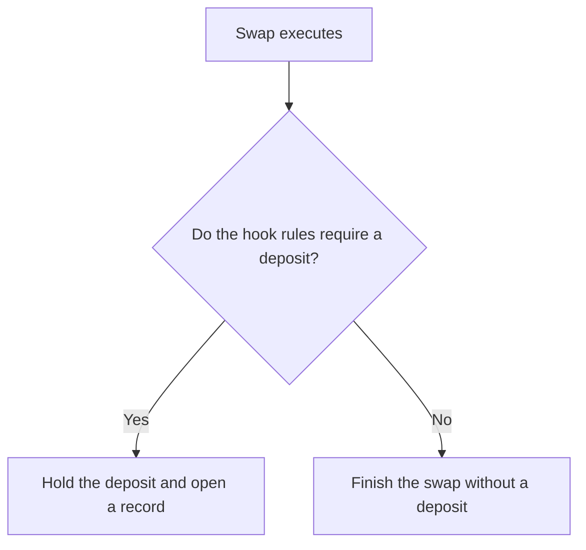
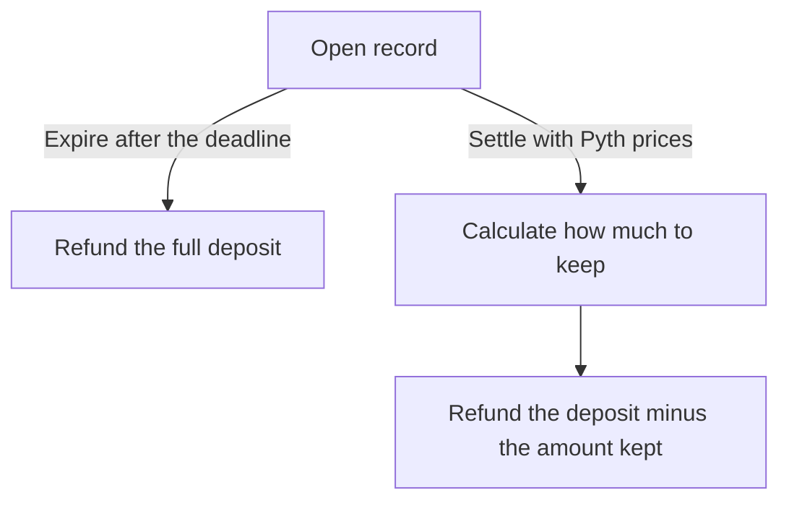
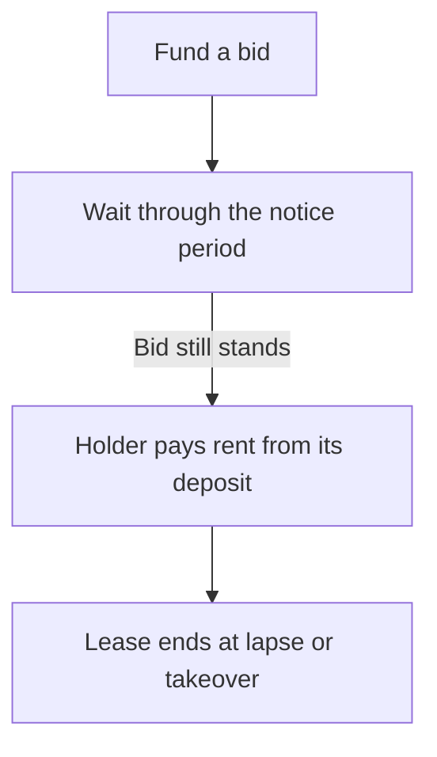

# Touchstone: formulas, research basis, and current implementation

Reviewed 6 November 2026. Repository base: `3a62063`; includes the E10 follow-up on `codex/m11-followup`. This describes the inspected working tree, not an assertion that this exact code is deployed. Existing deployments require their own manifest and bytecode comparison.

This document separates **contract arithmetic**, **research calculations**, and **design assumptions**. There are no invented transaction results or demonstration numbers here. Synthetic tests establish software behavior for their inputs; they do not establish economic profitability. “Proof of work” below means inspectable code, recorded results and reproducible checks, not blockchain proof-of-work consensus or a formal verification certificate.

## 1. Where the formulas came from

| Basis | What it supports | What it does not establish |
| --- | --- | --- |
| [Uniswap v4 overview](https://developers.uniswap.org/docs/protocols/v4/overview), [hooks](https://developers.uniswap.org/docs/protocols/v4/concepts/hooks), [flash accounting](https://developers.uniswap.org/docs/protocols/v4/concepts/flash-accounting), and [v4-core](https://github.com/Uniswap/v4-core) | Pool execution, hook callbacks, signed currency deltas, claims accounting and concentrated-liquidity arithmetic | Touchstone's deposit rate, retention share, margin, triggers or economic success |
| Milionis, Moallemi, Roughgarden and Zhang, [Automated Market Making and Loss-Versus-Rebalancing](https://arxiv.org/html/2208.06046v6), especially §6, Eq. 19 | The LVR framework and constant-product instantaneous loss rate | A per-swap Touchstone fee or a universal loss rate for concentrated liquidity |
| Sadeghi, Liu, Moallemi, Wan and Zhu, [Not All LPs Are Equal](https://arxiv.org/html/2609.37963v2), §4.1 and Appendix H | Markout-based LP measurement and the distinction between passive LP and aggregate pool outcomes | That a three-second Pyth settlement is equivalent to their benchmark methodology, or that Touchstone improves passive LP returns |
| Adams, Moallemi, Reynolds and Robinson, [am-AMM](https://arxiv.org/abs/2403.03367v4) | Auctioning temporary management rights as a mechanism for passing value to LPs | Touchstone's specific licence exemption, band or bidder-model equilibrium; am-AMM's fee-setting manager differs from Touchstone |
| [Hindsight](https://github.com/OoJae/hindsight-hook) | Public prior art for an ex-post markout-settled v4 fee/bond mechanism | Independent validation of Touchstone; ex-post settlement is not claimed as Touchstone's invention |
| [Pyth unique-update API](https://api-reference.pyth.network/price-feeds/evm/parsePriceFeedUpdatesUnique) | Selecting the first authenticated update at or after a target time for each feed | Oracle accuracy, identical publication times for two feeds, or guaranteed availability |
| Touchstone [specification §4](developer-spec-2026-10-25.md#41-notation), decisions and current source | The particular clipped retention rule, deposit schedule, confidence allowance, trigger combination, rebate allocation and implementation choices | A theorem that those choices are optimal |

The new E10 path code extends the repository's existing first-race and constant-product models. Its accounting is derived from the stated model and contract allocation rules. It is not a formula copied from a paper, a bytecode replay, or evidence that a licence should be enabled.

## 2. Units and common variables

Unless explicitly labeled as research-model whole-token amounts, contract amounts are **integer token base units**. One unit of a token with `d` decimals is `10^d` base units.

| Symbol | Meaning / code representation | Units |
| --- | --- | --- |
| `B` | `BPS = 10_000` | Basis-point denominator |
| `U` | `PIPS = 1_000_000` | Uniswap fee denominator |
| `S` | `PRICE_SCALE = 10^36` | Touchstone price scale |
| `Q96` | `2^96` | v4 square-root price scale |
| `x_r`, `x_q` | Trader's risky/quote receipts from the AMM delta, before the hook deposit | Signed risky/quote base units; receipt positive, payment negative |
| `q = abs(x_r)` | Risky quantity | Risky base units |
| `N = abs(x_q)` | Observed quote notional, including the executed fee through actual receipts | Quote base units |
| `s` | `+1` for buying risky, `−1` for selling risky | Direction only |
| `p_pre` | Pool price immediately before execution | Quote per risky, with consistent units |
| `P_ref` | Swap-time Chainlink reference | Same units as pool price |
| `P*` / `P_X` | Settlement Pyth ratio; `P_X = P* × S` in base-unit convention | Quote base units per risky base unit, scaled by `S` for `P_X` |
| `f` / `feePips` | LP fee as a fraction / integer pips | `f = feePips/U` |
| `f_swap` | Executed combined swap fee, snapshotted as `swapFeePips` | Integer pips; includes directional v4 protocol fee |
| `D`, `R` | Deposit and retained amount | Deposit currency unless suffixed `q` for quote |
| `m`, `m_ITM` | Full-swap and in-the-money markout | Signed quote base units |
| `N_ITM` | In-the-money leg's absolute quote receipt | Quote base units |
| `floor`, `ceil` | Integer rounding down / up | Applied at each indicated step, not only at the end |

`alphaBps=8000` means a fraction of `0.8`; `feePips=500` means `0.0005`, or 5 bps. These explain encoding, not a claim that every registered pool uses those values. Per-pool configuration is fixed at registration; obtain actual settings from the factory and the deployment being inspected.

## 3. Execution and price normalization

**Current code:** [TouchstoneHook](../contracts/src/TouchstoneHook.sol) `_beforeSwap`, `_view`, `_takeDeposit`; [PriceLib](../contracts/src/libraries/PriceLib.sol); [ReferenceLib](../contracts/src/libraries/ReferenceLib.sol).

The hook snapshots pre-swap square-root price, active liquidity and executed fee. After v4 executes the AMM swap, the hook derives `N` and `q` from the actual delta. It does not estimate notional from the requested input.

For `z = sqrtPriceX96`, token1/token0 price is `(z/Q96)^2`. If risky is token0, quote/risky price is this ratio; otherwise it is its reciprocal. `PriceLib.poolPriceX36` converts to `S` scale, using a two-stage multiplication when the square would overflow 256 bits. Therefore the algebraic ratio is not a promise of infinite-precision arithmetic at extreme prices. `sqrtPriceX96At` performs the reverse conversion with integer square roots and scale-dependent rounding.

For Pyth positive price integers `p_b`, `p_q`, exponents `e_b`, `e_q`, and token decimals `d_r`, `d_q`:

```text
k = e_b - e_q + d_q - d_r + 36
P_X = floor(p_b * 10^k / p_q)                    when k >= 0
P_X = floor(p_b / (p_q * 10^(-k)))               when k < 0
c_bps = ceil(B * (conf_b*p_q + conf_q*p_b) / (p_b*p_q))
```

`conf_b` and `conf_q` are each feed's confidence in its price-integer units. `c_bps` sums relative confidence widths; it is a protocol allowance, not a statistically calibrated confidence probability for the ratio. Nonpositive prices and exponents outside the supported range revert.

For Chainlink answer `a` and feed decimals `d_feed`, the conversion is `a × 10^(36+d_q-d_r-d_feed)`, flooring if division is needed. The feed is interpreted as risky value in whole quote tokens. A USD feed used for a USDC quote therefore assumes the quote tracks that denomination; this swap-time reference is not the Pyth two-feed ratio. Failed, malformed, stale, future-dated or nonpositive answers are unavailable. Sequencer uptime checks also gate reference use. Without a usable reference, drift does not fire, the deposit uses its floor rate, and the licence fast exemption is unavailable.

**v4 accounting consequence:** `afterSwap` returns a delta in the unspecified currency. This is output for exact input, input for exact output. The hook mints ERC-6909 claims for its deposit. Thus a deposit reduces immediate output in exact-input mode and increases immediate input payment in exact-output mode. It is escrow, not all final fee revenue. This follows [v4's hook interface](https://github.com/Uniswap/v4-core/blob/main/src/interfaces/IHooks.sol) and the local hook implementation.

## 4. Triggers and deposit

**Current code:** [TriggerLib](../contracts/src/libraries/TriggerLib.sol), [FlowBucketLib](../contracts/src/libraries/FlowBucketLib.sol), [DepositLib](../contracts/src/libraries/DepositLib.sol), and `TouchstoneHook._evaluate`.

**When does a swap open a record?**



The signed reference gap, in ordinary notation, is:

```text
g_bps = trunc_toward_zero(B * s * (P_ref - p_pre) / P_ref)
```

`PriceLib.signedGapBps` saturates extreme magnitudes at `int128.max`; ordinary gaps use full-precision multiplication/division. Positive means trading toward the reference.

For each direction, let `b` be its decoded bucket level, `t_last` the shared last-update time, `t` the current time, `N_min = nMin`, and `h = flowHorizon`:

```text
drain = floor(N_min * (t - t_last) / h)
b_drained = max(0, b - drain)
b_new = min(2^104 - 2, b_drained + N)       for the traded direction
```

The other bucket is drained but not incremented. Stored levels use `b+1`; an unwritten zero decodes to zero. The flow flag fires when the traded direction reaches `N_min`. Every swap feeds the bucket, including below-floor swaps.

For swaps with `N >= n0`, the other triggers are first touch, closed-market status, and drift `g_bps >= tauBps`. First touch uses a persistent block marker plus a transaction-local marker; later qualifying swaps in that transaction can also be flagged. The holder's exemption is narrower: its first qualifying touch must precede consumption of that block's status. `BlockLib` selects the configured chain block source, including ArbSys where configured.

For continuous records:

```text
scaledGap = floor(betaX100 * max(g_bps, 0) / 100)
rate_bps = min(deltaMaxBps, max(deltaBps, scaledGap))
D_q = floor(N * rate_bps / B)
```

`betaX100` encodes the multiplier times 100. Closure records instead use `rate_bps = deltaClosedBps`. If the unspecified token is risky:

```text
D = floor(D_q * q / N)
```

Otherwise `D = D_q`. Conversion uses the swap's execution ratio; no additional oracle conversion is used for taking the deposit.

A nonzero trigger is not sufficient to guarantee a deposit. Zero legs, unknown calendar state, licence exemption, integer rounding to zero, outstanding-currency overflow or exhausted `maxOutstanding` budget can result in no deposit. For outstanding quote/risky amounts `O_q`, `O_r`, budget `M`, the budget check requires:

```text
O_q + D_q <= M
O_r <= floor((M - O_q - D_q) * q / N)
```

`M=0` does not disable this check: a positive proposed quote deposit fails the budget check. It values old risky escrow at the current execution ratio; it is not a permanent market-value ceiling.

## 5. Settlement time and markout

**Current code:** [Settler](../contracts/src/Settler.sol) `_settleTime`, `_payout`; [SettlementMath](../contracts/src/libraries/SettlementMath.sol) `markout`.

| Mode | Earliest target `t0` | Latest accepted feed time | Expiry becomes callable |
| --- | --- | --- | --- |
| Continuous | `record.timestamp + settleDelay` | `t0 + maxLag` | `t0 + window` |
| Closed market | `calendar.nextOpen(record.timestamp) + openDelay` | `t0 + maxLagClosed` | `t0 + windowClosed` |

The calendar trigger considers whether the market is closed now or at `now + settleDelay + maxLag`. Its configuration validity and next-open availability matter; this is not a hardcoded weekend-only calendar.

For each Pyth feed, the unique-update constraint is:

```text
previousPublishTime < t0 <= publishTime <= latest
```

The feed pair need not share a publication timestamp. A caller cannot substitute an arbitrary later price that fails this condition. Calls require the Pyth update fee. Expiry refunds the deposit without a tip or rebate. Expiry eligibility does not automatically close a record: settlement and expiry both require the record still to be open.

The executable markout is:

```text
m = floor(x_r * P_X / S) + x_q
```

For negative `x_r`, code implements this as `x_q - ceil(abs(x_r)*P_X/S)`. It is rounded toward negative infinity. In consistent real-number units it is the accounting identity `m = s*q*(P* - P_exec)`, where `P_exec = abs(x_q)/abs(x_r)` includes the executed fee through the actual receipts. Positive `m` is a favorable trader markout and unfavorable pool-side trade cash flow at that reference price. It is not proof of malicious intent or the complete return of a particular LP position. The markout measurement basis is discussed in [Sadeghi et al. §4.1](https://arxiv.org/html/2609.37963v2#S4.SS1); Touchstone's horizon and oracle are its own choices.

## 6. In-the-money accounting and its approximation

**Current code:** [ItmLib](../contracts/src/libraries/ItmLib.sol) `leg`; `Settler._inTheMoney`.

With ITM accounting off, the contract uses full receipts: `m_ITM=m`, `N_ITM=N`. With it on, swaps that do not overshoot still use actual full receipts. For an overshoot, the contract reconstructs only the leg up to the square-root settlement price using **pre-swap active liquidity**.

For unscaled square-root prices `a < b` and active liquidity `L_active`, v4's amount identities are:

```text
amount0_net = L_active * (1/a - 1/b)
amount1_net = L_active * (b - a)
input_gross = ceil(input_net * U / (U - swapFeePips))
```

`SqrtPriceMath` applies the fixed-point scaling and rounds inputs up and outputs down. Direction determines the signed input/output legs. The clipped endpoint is the fair square-root price only when the executed path passes it. A trade starting on the non-profitable side can yield a zero ITM leg.

The hook snapshots the combined fee, including the directional v4 protocol fee, for this reconstruction. For directional protocol fee `p_fee` and LP fee `l_fee`, both in pips, the pinned library computes `swapFeePips = p_fee + l_fee - floor(p_fee*l_fee/U)`; `p_fee=0` gives the LP fee directly. Rebates separately use the pool's static LP fee. See [Uniswap SqrtPriceMath](https://github.com/Uniswap/v4-core/blob/main/src/libraries/SqrtPriceMath.sol), [SwapMath](https://github.com/Uniswap/v4-core/blob/main/src/libraries/SwapMath.sol), and [ProtocolFeeLibrary](https://github.com/Uniswap/v4-core/blob/main/src/libraries/ProtocolFeeLibrary.sol).

**Known limit:** liquidity changes across initialized ticks are not reconstructed in this settlement leg. Applying one `L_active` across such a path is approximate. The current Python replay is not independent proof of exact tick reconstruction. The view quote loop described later is a separate implementation and does not remove this settlement limitation.

## 7. Retention, refund, and guards

**Current code:** `Settler._payout`, `_inBand`, `_jumped`, and `SettlementMath.clawback`.

**What happens to the deposit?**



Settlement's licence-band test is:

```text
ceil(B * abs(p_pre_X - P_X) / P_X) <= bandBps
```

The applicable retention coefficient `a_bps` is selected in this order:

| Condition | Coefficient |
| --- | --- |
| Closure record | `alphaClosedBps` |
| No recorded active licence, or outside settlement band | `alphaBps` |
| Active licence, inside band, recorded holder first touch | `0` |
| Active licence, inside band, other trader | `alphaLicensedBps` |

The deposit's settlement quote value is `D_q_settle = D` for quote deposits, or `floor(D*P_X/S)` for risky deposits. Then:

```text
e_bps = epsClosedBps for closure, otherwise epsBps
margin = floor(N_ITM * (e_bps + c_bps) / B)
R_q = min(D_q_settle, floor(a_bps * max(0, m_ITM - margin) / B))
R = R_q                                      for quote deposits
R = floor(R_q * S / P_X)                      for risky deposits
refund = D - R
```

The code returns zero retention immediately for `m_ITM <= 0` or `a_bps=0`. Floors occur in separate stages; rounding the margin down can slightly increase retention relative to exact rational arithmetic. It is therefore inaccurate to say that *every* rounding operation favors the trader. Markout-down, confidence-up and retained-amount-down each have their stated individual effects.

The entire deposit is refunded if `c_bps > maxConfBps`. For closure records the jump guard also refunds if:

```text
p_exec_X = floor(abs(x_q) * S / abs(x_r))
floor(B * abs(P_X - p_exec_X) / p_exec_X) > jumpRefundBps
```

Zero execution legs trigger the closure jump refund. The floor before comparison is part of the implemented boundary. These guards refund, rather than creating an economic verdict about why the oracle moved.

The clipped retention formula is Touchstone policy. LVR and markout papers motivate measuring adverse selection; they do not derive these configured shares, margins or caps.

## 8. Payout split, rebates, and conservation

**Current code:** `SettlementMath.splitRetained`, `benign`, `conserves`; `TouchstoneHook.finalize` and `_account`.

All following amounts are in the deposit currency. Let `T_cap` be `tipCap` converted from quote at `P_X` when necessary, with the code's uint128 cap.

```text
tip = min(T_cap, floor(R * tipBps / B))
rest1 = R - tip
protocol = floor(rest1 * protocolShareBps / B)
rest2 = rest1 - protocol
rebateFunding = floor(rest2 * rhoBps / B)
LP_vesting = rest2 - rebateFunding
refund + tip + protocol + rebateFunding + LP_vesting = D
```

`rhoBps` is a share after tip and protocol deductions, not a share of the original deposit. Retained value is not all immediate LP income.

A benign rebate is considered only when **`R_q == 0` and full-swap `m <= 0`**. A small positive markout inside the margin can receive a refund without qualifying for a rebate. Define `N_dep` as `N` for quote deposits, or `floor(N*S/P_X)` for risky deposits. Let `B_pool` be that pool/currency's available rebate budget:

```text
gross = min(B_pool, floor(N_dep * feePips * kappaBps / (U * B)))
rebateTip = min(T_cap, floor(gross * tipBps / B))
rebateToBeneficiary = gross - rebateTip
refund = D
```

The static LP fee is used here, not the whole combined protocol-plus-LP execution fee. Tips reduce the beneficiary's rebate. The budget is debited by `gross`; no unlimited rebate obligation is created. Guard-triggered full refunds bypass this benign-rebate path.

The hook rechecks payout conservation before finalization. A failed immediate token delivery can leave a ledger entitlement; a successful settlement is not always immediate wallet receipt. These checks prove an accounting property when execution succeeds, not that oracle inputs reflect economic fair value.

## 9. Vesting and the actual licence auction

**Current code:** [VestingLib](../contracts/src/libraries/VestingLib.sol), `TouchstoneHook._dripEffects`, `_creditRent`; [LicenceAuction](../contracts/src/LicenceAuction.sol).

For remaining vesting buffer `V_buf`, time since last drip `dt`, and configured `T_vest=vestPeriod`:

```text
released = V_buf                              if dt >= T_vest
released = floor(V_buf * dt / T_vest)          otherwise
V_buf_next = V_buf - released
```

This recalculates from the remaining buffer; frequent drips change the schedule. It is not a fixed linear release for each original deposit. With no in-range liquidity, nothing is released and the clock resets. Donations benefit liquidity in range when donation executes. Vesting does not enforce a holding period or eliminate JIT capture.

**How does the on-chain licence change hands?**



Auction variables are `r_top`, `r_pending` (quote base units/second), `r_min=minRent`, `i=minIncrementBps`, `K=k` (seconds), and lease deposit `A` (quote base units):

```text
r_base = max(r_top, r_pending)
r_required = r_min                                           if r_base == 0
r_required = max(r_min, min(uint128.max,
                           ceil(r_base*(B+i)/B)))             otherwise
A >= r_bid * K
t_activate = pending.since + K
t_lapse = holder.since + floor(A / r_holder)
rentCharged = r_holder * (until - holder.since)
```

`until` stops at the appropriate transition or lapse time. A remainder smaller than one second's rent is returned on lapse. The contract applies pending activation, displacement and rent charging chronologically; it does not charge beyond funded whole seconds. Lease ownership controls the deposit; `swapper` names the address eligible for exemption.

The swap-time exemption requires a live licence, a large continuous-mode swap, holder identity, unused block first-touch status, and a usable reference gap within `bandBps`. It creates no settlement record, so there is no later Pyth recheck of that exempt swap. Slow-path records use the settlement regime in §7. A stale reference therefore matters differently on the two paths.

Rent allocation has **no settler tip**:

```text
rentProtocol = floor(rentCharged * protocolShareBps / B)
rentRebate = floor((rentCharged-rentProtocol) * rhoBps / B)
rentVest = rentCharged - rentProtocol - rentRebate
```

This is an adaptation of auction-based management rights, not am-AMM's identical mechanism. The holder cannot set or collect the pool's ordinary LP fee. The on-chain auction is not a sealed-bid second-price auction. Its implementation and terms are inspectable in [ILicenceAuction](../contracts/src/interfaces/ILicenceAuction.sol).

## 10. Quote and router formulas

**Current code:** [StaticQuoteLib](../contracts/src/libraries/StaticQuoteLib.sol), [TouchstoneLens](../contracts/src/periphery/TouchstoneLens.sol), [GuardedRouter](../contracts/src/periphery/GuardedRouter.sol).

The view quote simulates the v4 swap step loop, including tick transitions and combined fee, then applies the deposit classification. It is bounded by initialized-tick crossings and empty bitmap-word steps; over-budget inputs return “cannot price.” This is not the constant-product research model.

The local quote gas estimate is `105000 + 17000*maxTicks`; `maxTicks` is the configured loop budget. These are implementation bounds based on local measurements, not a network-independent gas theorem.

Router guards enforce:

```text
D_actual <= maxDeposit
exact input:  netOutput >= minNetOut
              netOutput + D_actual >= minGrossOut
exact output: netInput <= maxNetIn
```

The exact-output branch does not separately assert full requested output after a price-limit partial fill. `depositIfFlagged` removes current trigger uncertainty at the current rate; it is not a bound over arbitrary future price/configuration/state changes. A quote is only meaningful for its inspected state.

## 11. Research metrics: formulas actually evaluated by code

These calculations are off-chain. They do not execute inside `TouchstoneHook`.

### E1/E2 trigger metrics

**Code:** [metrics.py](../research/tsr/metrics.py), [stats.py](../research/tsr/stats.py).

For observation `i`, full markout `m_i`, quote notional `N_i`, binary flag `I_i`, and fractional margin `eps`:

```text
toxic_i = max(0, m_i - eps*N_i)
recall = sum(I_i*toxic_i) / sum(toxic_i)
flag_count_share = sum(I_i) / number_of_swaps
flag_volume_share = sum(I_i*N_i) / sum(N_i)
r_star = sum(m_i) / (alpha * sum(toxic_i))
```

`alpha=ALPHA_BPS/B`, `eps=EPS_BPS/B`. Markout already includes fee effects; subtracting the LP fee again would double-count them. Undefined toxic denominators return NaN rather than evidence of passing. Grid selection uses development recall subject to the flag-count constraint, then ties by lower flag count and larger `N0`.

The registered historical benchmark is not identical to authenticated on-chain Pyth settlement. Whole UTC days are resampled with replacement for interval estimation; the interval is the 2.5th–97.5th percentile of bootstrap statistics. That addresses within-day dependence, not every possible sampling bias.

### E3 settlement metrics and E4 oracle basis

**Code:** [e3_settlement.py](../research/experiments/e3_settlement.py), [e4_basis.py](../research/experiments/e4_basis.py).

```text
cap_share = sum(toxic weight of cap-bound records) / sum(toxic weight)
retail_fee_bps = F_BPS + B*sum(retained - rebate)/sum(retail notional)
mean_deposit_bps = B*sum(flagged deposit quote value)/sum(flagged notional)
static_LP = -sum(full 15-second trader markouts)
touchstone_LP = static_LP + sum(to_LPs)
basis_i_bps = B*abs(m_i_Pyth - m_i_Binance)/abs(x_q_i)
```

Each statistic uses its explicit subset/window. E4 reports median, mean and 90th percentile basis plus a day-bootstrap median interval; late updates are counted as dropped. The frozen E4 decision uses the three-second median and a 1 bp kill line. These are registered policy thresholds, not outputs proven by the oracle documentation. There are no published E3/E4 verdict files in the inspected checkout.

### E5/E6 behavior models

**Code:** [evasion.py](../research/simulations/evasion.py), [freshness.py](../research/simulations/freshness.py), [behavior runner](../research/experiments/behaviour.py).

E5 splits parent trades into the registered child sizes/times and recomputes first-touch/flow/drift flags and toxic-weight recall. It is a trigger-evasion calculation; it does not establish profitability after gas, delay risk and exact-output consequences.

E6 uses real outside-price inputs with a **stylized constant-product response model**. Let `x,y` be positive risky/quote reserves, `k=x*y`, `P` the current outside price, `N` quote notional, and `a=1-fee_bps/B`:

```text
Buy risky:
  quote_net = a*N
  risky_out = x - k/(y+quote_net)
  x_next = x-risky_out; y_next = y+quote_net
  m = risky_out*P-N
  N_to_fair = max(0, sqrt(k*P)-y)/a
Sell risky:
  risky_in = (k/(y-N)-x)/a                  requires N < y
  x_next = x+a*risky_in; y_next = y-N
  m = N-risky_in*P
  N_to_fair = max(0, y-sqrt(k*P))
```

The ITM leg is capped at `N_to_fair`. For a candidate grid size:

```text
R_model = min(N*deposit_bps/B,
              alpha_bps/B * max(0, m_ITM-eps_bps*N_ITM/B))
profit = m-R_model-cost_bps*N/B-gas_quote
```

`cost_bps` is modeled hedging cost; `gas_quote` is fixed quote-valued gas. The model chooses the highest strictly positive grid profit or abstains. Fees are tracked outside the reserves, so `k` remains constant. This is actual research code, but it is neither a v4 pool state nor a concentrated-liquidity replay. Confidence, tick state and live transaction ordering are not reproduced by these equations.

The E6 runner measures `mean_absolute_error = sum(abs(pool_price_j-outside_price_j))/sample_count` separately for each policy over its one-second observations. `freshness_ratio = sum(Touchstone errors)/sum(static errors)`, with a registered kill when the ratio exceeds `1.1`. It rejects a zero static denominator. These are absolute price errors in quote per risky token, unlike E10's basis-point, interval-weighted gap. Observation latency can mean the agent trades on an older price while error is scored against the current price.

### E10 licence model and the follow-up path code

**Code:** [licence.py](../research/simulations/licence.py), [licence_path.py](../research/simulations/licence_path.py). Status: **draft; no historical E10 verdict**.

Each `Arrival` has bidder identity, latency, hedge cost in bps and gas in quote units. `Terms` supplies `n0`, `band_bps`, `alpha_bps`, `licensed_alpha_bps`, `eps_bps`, `delta_bps`, `delta_max_bps`, `beta`, `tip_bps`, `tip_cap`, `rho_bps`, `protocol_bps`. Here `beta` is the direct multiplier, not Solidity's `betaX100`.

The model computes `gap=B*abs(pool.spot-fair)/fair`, chooses a profitable size using the current fair observation, and gives the fill to the first profitable arrival. Latency ties preserve supplied order. Later `settled` and `markout_price` observations affect realized retention and LP markout; they do not choose the trade. `markout_price` is intended as the separate 15-second valuation, but the caller must provide it correctly—the model cannot verify that timing.

```text
trader_profit = execution_markout_at_fair - hedge_bps*N/B - gas - realized_R
LP_trade_income = -execution_markout_at_markout_price
                  + (R-min(tip_cap,tip_bps*R/B))
                    *(1-protocol_bps/B)*(1-rho_bps/B)
```

These calculations use floating-point model units, not Solidity's integer floors. A fast-exempt holder remains exempt in the modeled settlement. The simulation admits at most one fill per observation and uses absolute gap for its deposit-rate calculation. The contract has signed gaps, more triggers and multiple swaps; equivalence is not claimed.

An `Observation` contains timestamp, current `fair`, later `settled`, separate `markout_price`, and arrivals. The path carries reserves between observations. With end time `t_end`, initial observation time `t_start`, interval lengths `dt_j`, post-race pool prices `p_j`, and fair observations `P_j`:

```text
T = t_end-t_start
rent_paid = rent_per_second*T
LP_rent = rent_paid*(1-protocol_bps/B)*(1-rho_bps/B)
LP_income = sum(LP_trade_income)+LP_rent
holder_win_rate = holder_fills/all_fills
mean_gap_bps = sum(B*abs(p_j-P_j)/P_j * dt_j)/T
bidder_value = pre_rent_profit_as_holder - pre_rent_profit_under_named_outsider_policy
```

Win rate is undefined (`None`) with no fills. Idle-holder runs remove holder arrivals but still charge rent. Arrival latencies must fit their observation interval. Freshness holds the post-race price over each interval and ignores waiting time within it. The path assumes a fully funded lease: no lapse, displacement, deposit-capital cost or settlement-budget timing.

`clearing_rent` qualifies valuations at or above a supplied reserve. One qualifying bidder pays the reserve; multiple bidders pay the second-highest qualifying valuation. Values and reserve are **total lease quote amounts**, while `replay_path` takes quote/second. Divide by the same duration before a paid replay. This is a modeling assumption; the actual contract uses the continuous rent auction in §9. Neither the paper nor these unit tests establish that modeled second-price bidding occurs in the deployed mechanism.

### E11 rebate budget and ownership model

**Code:** [rebates.py](../research/simulations/rebates.py). Status: **draft**.

```text
budget_next = budget + allocated_retention_funding - rebate_paid - rebate_tip
gross_coverage = (rebates_paid + rebate_tips)/requested_gross_rebates
owner_share_j = sum(active liquidity identified as owner j)/sum(all active liquidity)
leg_profit = markout_after_fee + LP_fee*owned_share
             + rebate_received - retained - gas
```

An active position satisfies `lower_tick <= tick < upper_tick`. Multiple positions of the same identified owner are aggregated. Zero active liquidity makes concentration undefined; zero rebate demand makes coverage undefined. Correct beneficial-owner identification is an input requirement, not something this function proves. The model does not yet establish that rebates attract benign flow or prevent self-LP farming.

## 12. Analytical motivation, not contract execution

These formulas appear in the specification/reference calculations. They must not be mistaken for measured Touchstone results.

**LVR background:** under the constant-product continuous-time assumptions in [Milionis et al., Eq. 19](https://arxiv.org/html/2208.06046v6#S6), instantaneous loss rate is `ell = sigma²*V/8`. `sigma` is volatility per square-root time; `V` is mark-to-market pool value; `ell` is value lost per unit time against the rebalancing benchmark. Concentrated-liquidity and discrete fee-bearing trading need their own treatment. No contract estimates `sigma` and charges this expression.

**Simplified arbitrage incentive:** with uncapped fractional retention `alpha`, excess margin `eps*N`, and full-swap markout `m`:

```text
pi_before_cost = m-alpha*max(0,m-eps*N)
              = m                              if m <= eps*N
              = (1-alpha)*m+alpha*eps*N         otherwise
```

For linear marginal cost `c` per quote notional, an interior taxed-region optimum satisfies `dm/dN = (c-alpha*eps)/(1-alpha)`. This algebra assumes that regime, no binding cap and a smooth trade-size model; the actual ITM rule, oracle noise, grid execution and fixed gas change it. It is not a proof of unchanged freshness. E6's recorded kill is evidence against generalizing that claim.

**Illustrative aggregate break-even:** [reference code](../research/reference/touchstone_ref.py) also computes

```text
r_star_illustrative = (L_loss-F_fee) /
                     (alpha*(L_loss-(f_arb+eps)*s_arb))
```

`L_loss` is gross adverse-selection loss, `F_fee` total fee income, `f_arb` the fee paid by arbitrage flow, all expressed consistently in bps of volume; `s_arb` is arbitrage volume share. This is an aggregate accounting approximation. E2 actually uses the sample formula in §11. A negative measured threshold must remain negative; it does not demonstrate evasion resistance.

**Closure noise calculation:** `touchstone_ref.noise_tax_bps` evaluates a normal positive-part expectation:

```text
z = (f_bps+eps_bps)/sigma_bps
expected_retention_bps = alpha*sigma_bps*(normal_pdf(z)-z*(1-normal_cdf(z)))
sigma_horizon_bps = daily_vol_fraction*sqrt(seconds/86400)*B
```

`normal_pdf` and `normal_cdf` are the standard normal density/distribution. `sigma_bps` is assumed noise over the horizon. This ignores deposit clipping, confidence, jump refunds and nonnormal jumps. It is a local analytical approximation, not an observed benign-trader tax; E9 is skipped.

**Simplified wash-leg loss:** `wash_leg_loss = f_bps*(1-kappa-owned_LP_share)`. `kappa` is fractional gross rebate share; `owned_LP_share` is the trader's own active-liquidity fraction. Ignoring impact, gas, tip and budget depletion, the expression becomes negative when `owned_LP_share > 1-kappa`. This explains why “wash trading always loses” is not a valid blanket statement. E11 uses explicit cash flows rather than treating this bound as a completed empirical result.

## 13. Configuration-variable index

The source of truth is [PoolConfig](../contracts/src/types/PoolConfig.sol), [LeaseParams](../contracts/src/interfaces/ILicenceAuction.sol), and factory validation. No universal live parameter values are inferred from test fixtures.

| Fields | Actual role / units |
| --- | --- |
| `n0`, `nMin` | Large-swap floor and flow threshold; quote base units |
| `flowHorizon`, `tauBps` | Bucket drain horizon in seconds; signed drift threshold in bps |
| `deltaBps`, `deltaMaxBps`, `betaX100`, `deltaClosedBps` | Deposit floor/cap, scaled gap multiplier, closure deposit rate |
| `referenceFeed`, `referenceMaxAge` | Chainlink address and maximum age in seconds |
| `basePriceId`, `quotePriceId` | Authenticated Pyth feed identities; they are not interchangeable with Chainlink addresses |
| `decimals0`, `decimals1`, `QUOTE_IS_0` | Token base-unit conversion and risky/quote role mapping |
| `calendar`, `calendarValidUntil` | Calendar contract and validity horizon; zero calendar means continuous crypto market |
| `settleDelay`, `maxLag`, `window` | Continuous target delay, accepted update lag, expiry window in seconds |
| `openDelay`, `maxLagClosed`, `windowClosed` | Closure equivalents measured from next open/target as in §5 |
| `maxConfBps`, `jumpRefundBps` | Confidence full-refund bound and closure execution-price jump bound |
| `alphaBps`, `alphaLicensedBps`, `alphaClosedBps` | Regime-specific retention shares in bps |
| `epsBps`, `epsClosedBps` | Margin allowances before adding oracle confidence, in bps of relevant notional |
| `bandBps` | Licence band width relative to the appropriate reference |
| `tipBps`, `tipCap` | Tip fraction in bps and quote-base-unit cap converted at settlement |
| `protocolShareBps`, `protocolRecipient` | Share of post-tip retention/rent and recipient; distinct from v4's directional protocol fee |
| `rhoBps`, `kappaBps` | Rebate-budget funding share and gross rebate fraction of LP fee |
| `vestPeriod`, `maxOutstanding` | Drip period in seconds; outstanding budget in quote base units |
| `flags` | Quote orientation, licence enabled, ITM enabled and factory-controlled calendar bit |
| Lease `k`, `minIncrementBps`, `minRent` | Activation notice in seconds, bid increment, reserve quote units/second |
| Lease `owner`, `swapper`, `since`, `rent`, `deposit` | Funder/controller, eligible swap identity, last accrual or bid time, rent rate, remaining funded quote units |

## 14. Evidence that exists, and what remains unproven

| Evidence | Recorded state | Interpretation |
| --- | --- | --- |
| [E1](../research/results/E1.json), [E2](../research/results/E2.json) | Saved historical backtests; E2 held-out recall `0.9893875018556911`, count flag share `0.23394607510385837`, `r_star=-0.3118807034660406` | One historical pool/window; negative break-even threshold makes clearing that line weak evidence |
| [E5](../research/results/E5.json), [write-up](../research/results/README.md) | No formal kill; finest splitting drops held-out recall to roughly 9.7–11.1% | Negative threshold cannot reject nonnegative recall; no full evasion-safety claim |
| [E6](../research/results/E6.json), [decision 0065](decisions/0065-e6-freshness-kill.md) | All 21 registered cases killed in both windows | Failed freshness evidence in the disclosed one-agent constant-product model; not a live LP-return measurement |
| E3/E4 | Frozen, no result files in this checkout | Oracle settlement and basis verdicts remain outstanding |
| E7/E10/E11/E12 | Draft / incomplete experimental evidence | Model code and local tests do not supply missing research verdicts |
| Contract verification in this work session | 254 tests passed; three RPC-dependent tests separately passed with the configured RPC | The three fork tests use external-chain contracts and recorded Hermes updates, with locally created test pool/tokens; not live deployment transactions or the sampled E12 study |
| Research/backend/frontend checks in this session | 93 / 95 / 50 tests passed; Rust checks passed | Engineering checks. Research fixtures and local Anvil/oracle fixtures are not economic observations |
| Release checks | Local reviewed coverage 99.69% lines / 100% branches; size/gas gates pass; Slither 132 findings, zero unreviewed | Reviewed coverage exclusions and accepted findings remain part of the evidence; not a formal proof or external audit |
| Hosted CI | Old PR retry interrupted by runner shutdown during coverage, exit 143 | That run covers the earlier PR head only |

The recorded E8 below-floor overhead is 21,522 gas against a 20,000 target, even though the separate regression gate passes. A gate pass must not erase that target miss. See [gas evidence](gas.md).

For reproducibility, the experiment artifacts carry input, preregistration and analysis hashes, with chronology in [FROZEN.md](../research/prereg/FROZEN.md). The raw historical data are gitignored; their presence on the owner's Mac does not imply presence in this Linux checkout. Follow [HANDOFF.md](HANDOFF.md) for current access and execution status.

To inspect the formulas without manufacturing new historical results:

```bash
# Exact arithmetic reference assertions and generated differential vectors (output outside the repo).
python3 -I research/reference/check_report_numbers.py /tmp/touchstone-formula-vectors
# Software/model tests; these are deliberately not historical experiment verdicts.
(cd research && uv run ruff check . && uv run mypy && uv run pytest)
# Contract behavior, when the pinned Foundry toolchain is available.
(cd contracts && forge test)
```

Concrete test entry points are [settlement](../contracts/test/unit/Settlement.t.sol), [protocol-fee settlement](../contracts/test/unit/ProtocolFeeSettlement.t.sol), [licence state transitions](../contracts/test/unit/Licence.t.sol), [licence invariants](../contracts/test/invariant/Licence.invariant.t.sol), [quote integrity](../contracts/test/unit/QuoteIntegrity.t.sol), and the [Arbitrum Sepolia fork fixture](../contracts/test/fork/ArbitrumSepoliaFork.t.sol). E10 follow-up accounting and causality tests are [test_licence_path.py](../research/tests/test_licence_path.py). The exact-reference script above was rerun successfully while preparing this document; its constructed vectors are arithmetic checks, not market observations.

The source map throughout this document is the auditable basis for what the code does. Research papers explain the motivation and inherited mathematics. Outstanding oracle, liquidity, routing and market-response assumptions remain visible in [the threat model](threat-model.md), [decision 0052](decisions/0052-d2-replay-scope-and-freeze.md) and the individual pre-registrations; a mechanically conserved payout does not by itself prove better economics.
